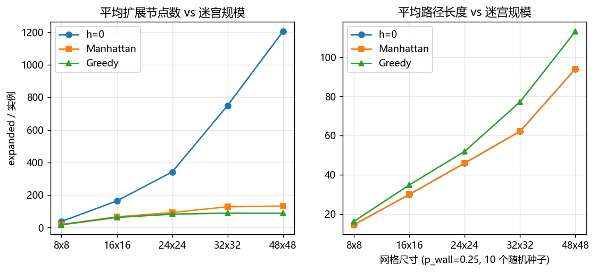
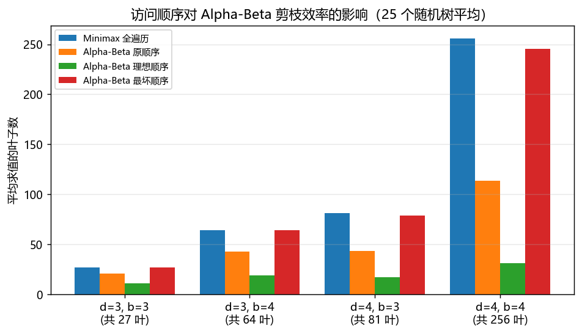
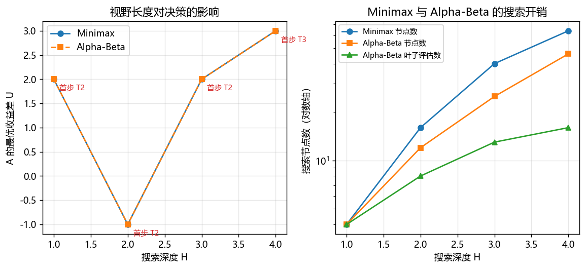

# 当代人工智能实验课 · 实验二 实验报告
<div class="sub">搜索算法：A\* 与 Alpha-Beta 剪枝的实现、对照实验与结果分析</div>

<table class="hdr">
<tr><td>姓名 / 学号</td><td>刘亭兰 / 10245501406</td><td>专业年级</td><td>数据科学与工程 2024 级</td><td>日期</td><td>2026-11-12</td></tr>
<tr><td>GitHub 仓库</td><td colspan="5"><code>https://github.com/WinkelzzZ/ai-lab2-search</code>（含 <code>src/</code> 代码、<code>tests/</code> 自检、<code>experiments/</code> 对照实验、<code>results/</code> 原始数据与图表，一条命令 <code>python experiments/run_all.py</code> 可全部复现）</td></tr>
<tr><td>运行环境</td><td colspan="5">Windows 11 / Python 3.12.7。算法实现零第三方依赖，只用标准库 <code>heapq</code>、<code>dataclasses</code>；<code>matplotlib</code> 仅用于绘图。报告内所有性能数字均来自代码内置计数器，非估计值。</td></tr>
</table>

## 1 算法设计

我没有为四道题各写一份搜索，而是写成**一个 A\* 内核 + 两组可换参数**（进入代价函数 `step_cost`、启发函数 `heuristic`），题目一、二、四的距离矩阵共用同一份实现；Alpha-Beta 单独实现但统一采集事件轨迹。

```python
# src/astar.py —— 内核主循环（简化）
open_heap = [(h(start), tie_key(0, h(start)), 0, start)]; g_score = {start: 0}
while open_heap:
    f, _, _, cur = heapq.heappop(open_heap)
    if cur in closed: stats.popped_stale += 1; continue      # 惰性跳过过期表项
    closed.add(cur); stats.expanded += 1
    if cur == goal: return 回溯 came_from(cur), g_score[cur], stats
    for nxt in grid.neighbors(cur):                          # 四邻域，X 不可进入
        ng = g_score[cur] + step_cost(cur, nxt)              # 题一恒为1；题二按地形
        if ng < g_score.get(nxt, inf):                       # 允许更优路径重新入队
            g_score[nxt] = ng; came_from[nxt] = cur
            heapq.heappush(open_heap, (ng + h(nxt), tie_key(ng, h(nxt)), next(cnt), nxt))
            stats.generated += 1
return [] / -1                                               # open 耗尽 => 无解
```

三点设计决定：**(1)** 用「发现更优 `g` 就重新入队 + 弹出时跳过 closed」的惰性写法，而不是入队即定死，保证带权地形（题目二）上仍最优；**(2)** 平局规则可切换，`tie_key` 返回 `h` / `-g`（deep）/ `g`（shallow），用来做 6 节对照；**(3)** 每次搜索采集 `expanded / generated / popped_stale / max_frontier / path_cost / wall_time_ms`，Alpha-Beta 采集 `nodes_visited / leaves_evaluated / cutoffs / children_skipped` 及逐步轨迹。

**Minimax 与 Alpha-Beta**（`src/problem3_alphabeta.py`）：`alphabeta(node, α, β)` 在 MAX 层 `α = max(α, v)`、MIN 层 `β = min(β, v)`，一旦 `α ≥ β` 立即 `break`，剩余兄弟子节点计入 `children_skipped`。题面 JSON 是 **DAG 而非树**（`max2` 同时是 `min1`、`min2` 的孩子），我按「访问次数」而非「不同节点数」计数，与题面 15 节点 / 8 叶的口径一致。

**题目四状态建模**：状态 = `(pos_A, pos_B, remaining, Score_A, Score_B, player)`，是冻结 dataclass；动作 = 当前玩家选一个未拿走的宝藏，收益用 A\* 现场算出的距离矩阵做增量 `gain = V(T) - d(prev, T)`，因此博弈树叶子只需 O(1) 查表，不再重复搜索。

## 2 题目一：迷宫寻路

**官方用例**（5×5，S=(0,0)，E=(3,4)）返回 `[(0,0),(0,1),(0,2),(1,2),(1,3),(1,4),(2,4),(3,4)]`，长度 8；无解用例（两堵墙封死 E）返回 `[]`。

| 启发式 | 平局规则 | 扩展 | 生成 | open峰值 | 路径长 | 耗时ms |
|---|---|---|---|---|---|---|
| h=0 (Dijkstra) | h | 17 | 18 | 3 | 7 | 0.154 |
| Manhattan | h | 14 | 17 | 4 | 7 | 0.099 |
| Manhattan | deep | 14 | 17 | 4 | 7 | 0.091 |
| Manhattan | shallow | 14 | 16 | 3 | 7 | 0.087 |
| 贪心最佳优先（只看 h） | — | 11 | 13 | 3 | **9** | 0.071 |

这 5 行已能说明两件事。其一，Manhattan 把扩展数从 17 降到 14 且路径不变：h=0 的扩展集是 `{n | g(n) ≤ C*}`，即半径 C\*=7 的菱形（理论 2·7²+1=99 格，被墙与边界截到 17 个实际可达），而 Manhattan 把扩展集压到「所有最短路径经过的格」这条 f=7 的等高线上，只剩 14 个。其二，**贪心扩展最少（11）但路径变长（9 步）**，因为它只按 h 排序、完全丢掉 g，会钻进「看着近、实际绕远」的死路——这正说明 A\* 的最优性来自 g+h 的组合而非 h 本身。

**规模对照**（随机迷宫，每格障碍概率 0.25，每档 10 个种子，取有解实例的平均值）：

| 尺寸 | 有解 | h=0 扩展 | Manhattan 扩展 | Greedy 扩展 | h=0 步长 | Man 步长 | Greedy 步长 |
|---|---|---|---|---|---|---|---|
| 8×8 | 7/10 | 37.6 | 19.2 | 17.6 | 14.57 | 14.57 | 16.29 |
| 16×16 | 7/10 | 164.0 | 66.4 | 62.8 | 30.0 | 30.0 | 34.86 |
| 24×24 | 7/10 | 342.4 | 92.7 | 82.9 | 46.0 | 46.0 | 52.0 |
| 32×32 | 10/10 | 750.3 | 128.2 | 89.1 | 62.2 | 62.2 | 77.2 |
| 48×48 | 7/10 | 1205.5 | 132.6 | 88.6 | 94.0 | 94.0 | 113.14 |

**扩展数差距随规模放大**：37.6→164→342→750→1205 近似按面积（半径线性→格子数平方）增长，而 Manhattan 从 19 涨到 133 就趋于饱和，比值从 1.96 倍拉到 **9.09 倍**。原因是障碍密度固定时可通行「走廊宽度」不再随网格变大，h 把扩展限制在走廊里；32×32 与 48×48 的 Manhattan 扩展数（128.2 / 132.6）几乎相同就是证据。h=0 与 Manhattan 的步长在每一档都完全相同，说明两者找到的都是最优解，只是搜索量不同。

## 3 题目二：加权地形

**官方用例返回 7**，无解返回 `-1`。题面第 7 页明确「最后一步没有代价，即可以将 E 视为 0」，我按此实现 `S=1 / E=0 / X=0`，并把路径代价逐步累计列出（`results/exp2_terrain.json`）：最优路径 7 步进入 `1+1+2+1+1+1+0 = 7`，若把 E 记为 1 则代价为 8。

| 启发式 | 代价 | 是否最优 | 扩展 | 生成 | 耗时ms |
|---|---|---|---|---|---|
| h=0 (Dijkstra) | 7 | True | 15 | 24 | 0.278 |
| Manhattan × c_min | 7 | True | 9 | 16 | 0.150 |
| Manhattan(终点免费) × c_min | 7 | True | 9 | 16 | 0.139 |

**核心问题是「终点免费」会不会破坏可采纳性。** 记最小进入代价 c_min=1，普通 Manhattan 对终点的邻居给出 d=1×c_min=1，而真实剩余代价是 0（踩进 E 不要钱），所以 **h 严格高估了 1，普通 Manhattan 在此模型下并不可采纳**。但它仍不破坏最优性，我的论证是：设最优代价为 C\*，任何被弹出的节点满足 f = g + d·c_min ≤ C\* + c_min，而终点自身 f = C\*，因此终点在 f 上不会输给任何尚未展开的更优候选；只有存在 f < C\* 的节点时才可能推迟终点，而这与 C\* 最优矛盾。为验证这个论证，我扫了 **365 个随机地形**：

| 地形设置 | 实例数 | naive Manhattan 取到最优 | 次优 | 扩展 ≤ Dijkstra 的比例 | 扩展差 |
|---|---|---|---|---|---|
| 权重 {1,2,3,4,5,8}，min=1（题面地形） | 120 | 120 | **0** | 75.0% | [-1, 0] |
| 无平原地带 min=2 | 120 | 120 | **0** | 69.2% | [-1, 0] |
| min=1 且高权重更多 | 60 | 60 | **0** | 91.7% | [-1, 0] |
| min=1 含障碍 X | 65 | 65 | **0** | 89.2% | [-1, 0] |

0 个反例，且 naive Manhattan 的扩展数在 75%~92% 的实例上**不大于** Dijkstra（差值只可能是 -1 或 0），与理论一致。反向对照：把 E 的代价改成 1（此时普通 Manhattan 严格可采纳），在官方用例上 `manhattan` 扩展 9、`manhattan_free` 反而扩展到 11——**启发式越紧不一定越省，关键是别高估**。

## 4 题目三：Alpha-Beta 剪枝

题面博弈树求值得 **5**（Minimax 与 Alpha-Beta 一致），统计如下：

| 方法 | 访问节点 | 求值叶子 | 内部节点 | 截断次数 | 跳过子节点 | 跳过叶子 |
|---|---|---|---|---|---|---|
| Minimax | 15 | 8 | 7 | 0 | 0 | 0 |
| Alpha-Beta | 14 | 7 | 7 | 2 | 1 | 1 |

**为什么只省 1 个叶子？** 从轨迹看，两次截断都发生在浅层 MIN 节点，被跳过的只有 `max2` 分支的最后一个叶子。这棵树只有 8 个叶子且深度 3，剪枝上界本来就低；更重要的是 `max2` 被 `min1`、`min2` 共享，无论哪条路径先访问它，第二个父节点仍需重新遍历其后代（我没有加记忆化，因为题面按访问次数计数）。

**访问顺序的影响**（随机树，每格 25 个种子的平均叶子求值数；完美排序理论下界：偶数深度 `2b^(d/2)−1`，奇数深度 `b^((d+1)/2)+b^((d−1)/2)−1`）：

| 深度 | 分支 | 总叶子 | Minimax | AB 原始顺序 | AB 理想顺序 | AB 最差顺序 | 理论下界 | 原始省 | 理想省 |
|---|---|---|---|---|---|---|---|---|---|
| 3 | 3 | 27 | 27.0 | 20.6 | 11.0 | 27.0 | **11** | 23.7% | 59.3% |
| 3 | 4 | 64 | 64.0 | 42.76 | 19.0 | 64.0 | **19** | 33.2% | 70.3% |
| 4 | 3 | 81 | 81.0 | 43.32 | 17.0 | 78.64 | **17** | 46.5% | 79.0% |
| 4 | 4 | 256 | 256.0 | 113.4 | 31.0 | 245.2 | **31** | 55.7% | 87.9% |

理想顺序的实测叶子数（11/19/17/31）**与理论下界逐格相等**，说明剪枝条件 `α ≥ β` 与窗口传递已做到该顺序下的极限；最差顺序下 AB 退化到接近 Minimax（245.2 vs 256）。以 d=4,b=4 为例，原始/理想/最差是 113.4 / 31.0 / 245.2，**同一棵树差近 8 倍**——剪枝收益不是算法白送的，是顺序给的。

<div class="figs">
<figure><figcaption>图1 迷宫规模与搜索量（题目一）</figcaption></figure>
<figure><figcaption>图2 访问顺序与叶子求值数（题目三）</figcaption></figure>
</div>

## 5 题目四：距离矩阵 + 博弈搜索

用 A\*（Manhattan）在 6×6 地图上对 6 个关键点 {A,B,T1..T4} 两两求最短代价，得 6×6 矩阵并做三项自检——对称性 True、三角不等式 True、与 h=0（Dijkstra）结果完全一致；总扩展数 Manhattan 275 vs Dijkstra 680（省 59.6%）。

| | A | B | T1 | T2 | T3 | T4 |
|---|---|---|---|---|---|---|
| **A** | 0 | 12 | 10 | 4 | 8 | 8 |
| **B** | 12 | 0 | 8 | 8 | 4 | 10 |
| **T1** | 10 | 8 | 0 | 6 | 6 | 12 |
| **T2** | 4 | 8 | 6 | 0 | 6 | 6 |
| **T3** | 8 | 4 | 6 | 6 | 0 | 6 |
| **T4** | 8 | 10 | 12 | 6 | 6 | 0 |

矩阵本身已透露全部博弈结构：A 离 T2 最近（4），B 离 T3 最近（4），而 T1、T4 分别对 A、B 都是 10 的「远端高价值点」。

即时收益 `Gain_i(T) = V(T) − d(i,T)`：T1=9−10=−1、T2=6−4=**+2**（A 最近）、T3=7−4=**+3**（B 最近）、T4=7−8=−1。四个宝藏的价值与距离高度错配，是这道题有意思的根源。

| H | 方法 | 节点 | 叶子 | 截断 | 跳过子节点 | 四个首步的值 | best_target | best_value |
|---|---|---|---|---|---|---|---|---|
| 1 | Minimax | 4 | 4 | — | — | T1 −1 / **T2 2** / T3 −1 / T4 −1 | T2 | 2 |
| 2 | Minimax | 16 | 12 | — | — | T1 −4 / **T2 −1** / T3 −2 / T4 −4 | **T2** | **−1** |
| 2 | Alpha-Beta | 12 | 8 | 2 | 4 | 同上（逐格一致） | T2 | −1 |
| 3 | Alpha-Beta | 25 | 13 | 5 | 7 | T1 −4 / **T2 2** / T3 −1 / T4 −4 | T2 | 2 |
| 4 | Minimax | 64 | 24 | — | — | T1 −5 / T2 1 / **T3 3** / T4 −7 | **T3** | **3** |
| 4 | Alpha-Beta | 46 | 16 | 12 | 6 | 同上（逐格一致） | T3 | 3 |

官方要求的两个输出：H=2 → `{"best_target":"T2","best_value":-1}`，H=4 → `{"best_target":"T3","best_value":3}`，两种方法、两种建树方式均一致（H=1..4 全部逐值核对通过）。

**H=2 与 H=4 给出不同首步——视野效应。** H=2 只看「我这一手 + 对手最坏一手」：A 抢 T2 得 +2，但 B 随后必抢 T3 得 +3，净 −1；A 改抢 T3 得 −1，B 抢 T2（对 B 是 −2）净 +1，然而实测 T3 分支的 H=2 值是 −2，因为 B 在 A 取 T3 后最佳回应是 T1（+1）而非 T2。四个首步 −4/−1/−2/−4 里 T2 最大，故选 T2。H=4 看满四回合，「位置」开始比「即时收益」值钱：A 先取 T3（净 −1）落到地图中心，T2、T4 距离都变 6，B 无论先取哪个都拿不到两个，主变例 `A:T3(−1) → B:T1(+1) → A:T2(6−6=0) → B:T4(7−12=−5)`，A 总收益差 (−1+0)−(1−5)=**3**。两个深度下的排序几乎反过来（H=2 时 T3 排第 3、H=4 时排第 1；T2 相反），这正是短视搜索的典型偏差。深度饱和实验显示 H=4/5/6/8 的结果与搜索量完全不变（46 节点 / 16 叶 / T3 / 3），因为 4 个宝藏最多 4 步就被取完，H>4 是空转。

<figure><figcaption>图3 视野长度 H 与最优首步、搜索开销（题目四）</figcaption></figure>

**两个负结果。** (1) 排序：按即时收益贪心排序反而**变慢**（natural 46 → greedy 49 节点），最差顺序 38、oracle 理想顺序 30。原因是剪枝依赖子树博弈值，而子树价值与「即时收益」在此题负相关——先搜高即时收益的分支往往是最晚才触发截断的弱分支。(2) 置换表缓存 **0 命中**（`cache_hits=0`，节点数不变）：本局状态里 `pos` 由最后一次选择唯一决定，同层不同到达顺序必然产生不同的 `(pos_A,pos_B,remaining)`，结构上不存在 transposition，因此记忆化在这类「无重复子问题」的选取博弈中是无用开销。这两点我是先按直觉实现、拿到反常数据后才回头解释的，比正向验证更有价值。

## 6 拓展实验

**加权 A\***（h 乘 w，12 个 16×16 实例）：w=1 时扩展 55.2、最优率 100%；w=1.5 扩展降到 41.9（−24%）但最优率 58.3%、平均次优比 1.027；w≥4 起数据完全停在 39.2 / 次优比 1.094 / 最优率 16.7%——因为本地图 h 的最大值固定，w 再大也不改变排序，权重 A\* 的收益存在饱和点。

**IDA\*** 对照 A\*（同实例、同代价）：8×8 到 24×24 上两者扩展数比约 1.46~1.51（IDA\* 因重复深搜略多），耗时 IDA\* 反而略快（0.188ms vs 0.216ms，路径浅、迭代次数≈1）。内存代理指标上 IDA\* 的**路径状态数只有 A\* open 峰值的 0.36~0.49**，但我的 `g`-map 会随搜索累积（24.3~96.5 个状态），所以在这类网格迷宫上 IDA\* 的内存优势并不显著——**这是一个负结果**：IDA\* 省内存的前提是状态空间深而宽、open 表爆炸，迷宫不满足。

**平局规则放大验证**：5×5 官方用例上 deep 与 shallow 扩展数相同（14），因为等高线只有 14 个点；放大到 16/24/32 网格后 shallow 的扩展数暴涨 **+161.5% / +184.3% / +144.9%**（45.2→118.2，90.2→256.4，189.0→462.8）。优先展开浅节点会把 f 相同的整层都翻一遍，验证了平局规则只在规模够大时才显现。

**宝藏价值敏感性**：把 T2 或 T3 的价值从 1 扫到 12，H=4 的最优首步在 **V=7** 处翻转（T2 从 7 起被选，T3 从 7 起被弃），与「距离 + 阈值收益」的边界一致，说明该决策对价值参数是分段稳定的而非噪声敏感。

## 7 结论与反思

1. **可采纳性与「跑对」要分开论证。** 题目二里普通 Manhattan 因终点免费而严格高估，实测 365 例仍 0 反例——不是它可采纳，而是高估量恰好被 f 的排序吸收。我最初担心会出反例，做完实验才把「不影响最优性」论证出来，这个来回是本次收获最大的一处。
2. **A\* 的价值随规模超线性放大。** 5×5 只省 3 个扩展（17→14），48×48 省 9.09 倍（1205→133），说明启发式的收益必须在足够大的实例上评估，小用例只能验证正确性。
3. **剪枝收益是顺序给的，不是算法给的。** 同一棵 d=4,b=4 的树，原始/理想/最差顺序求值 113.4/31.0/245.2 个叶子，理想顺序实测值与 `2b^(d/2)−1` 完全吻合；题目四的贪心排序甚至不如自然顺序。
4. **博弈深度存在「够用即饱和」。** H=2 与 H=4 首步不同（视野效应），H≥4 后结果与开销都不变，因为宝藏总数限制了有效博弈长度。
5. **不足**：题目四只用了题面给定的一张地图，未系统构造多组宝藏位置来统计视野效应出现的频率；距离矩阵用 k² 次单源 A\*，可改为 k 次全源 Dijkstra 压缩预处理；未实现更紧的启发式（如考虑地形的下界）；单次耗时受调度噪声影响，因此全文以扩展数/叶子数为主指标、耗时仅作参考。
